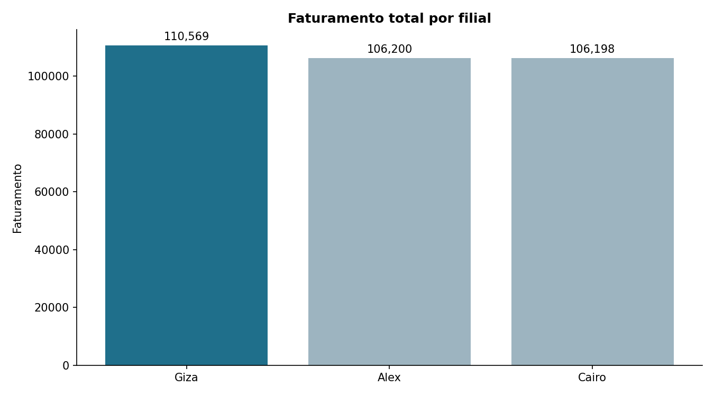
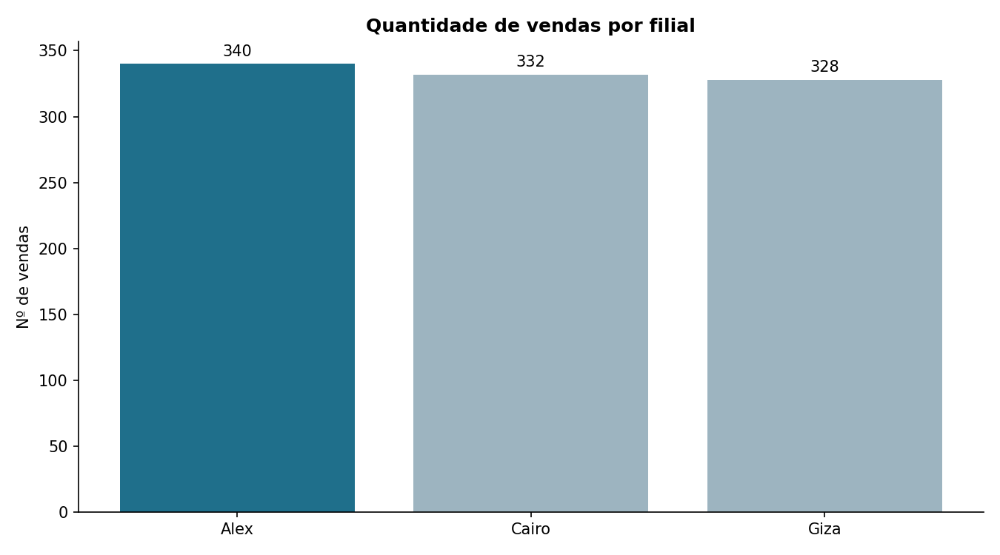
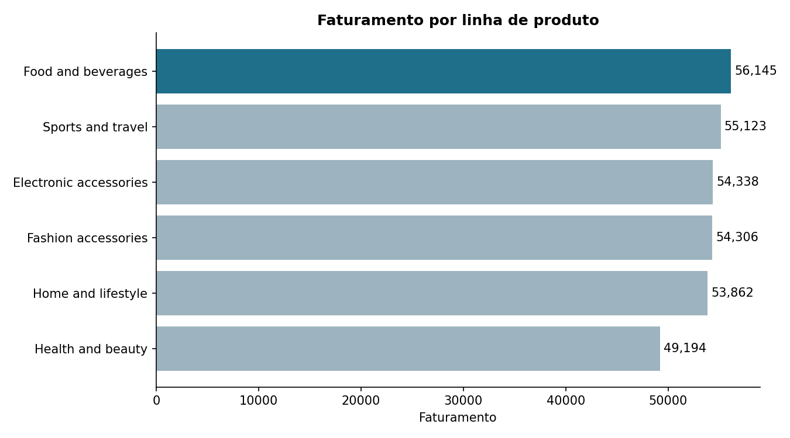
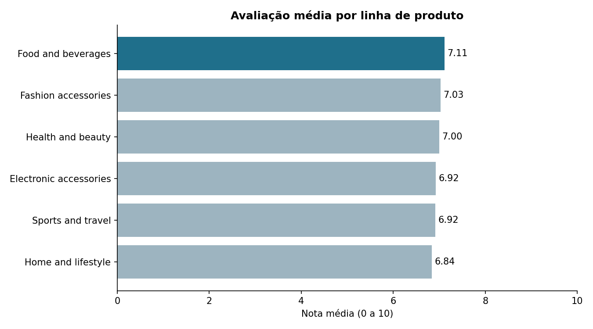
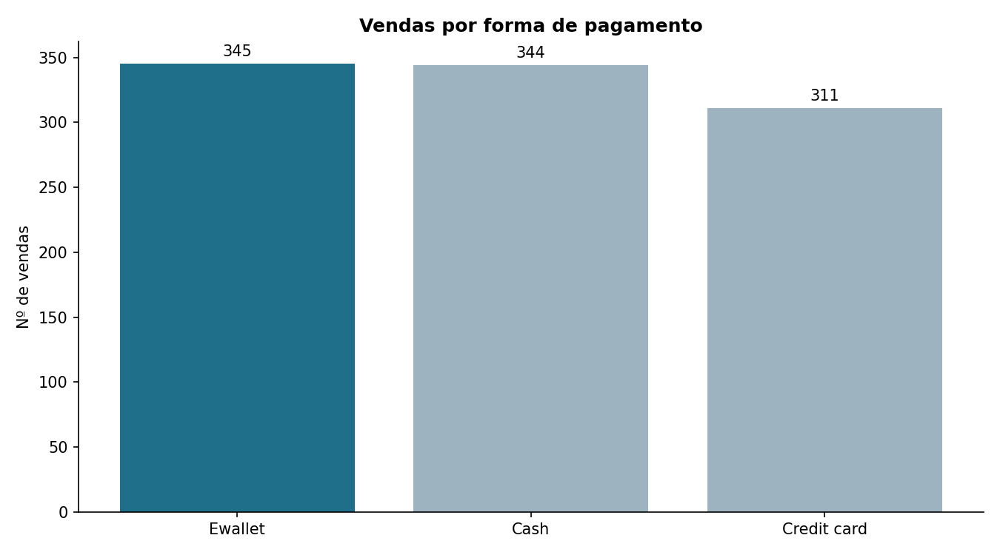
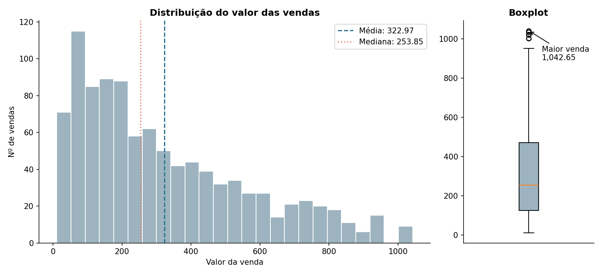
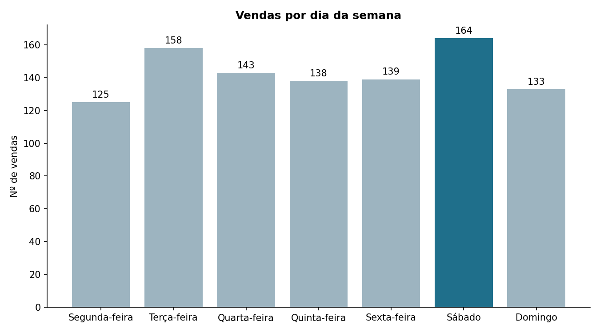

# Projeto M1: Análise de Dados de Vendas de Supermercado

Pipeline de dados com PostgreSQL, SQL, Python e Pandas, em camadas Raw, Tratada e Resultados,
para responder perguntas de negócio de uma rede de supermercados.

**Autor:** Anderson Antonio de Andrade

**Curso/Módulo:** Análise de Dados com Python, Módulo 1 (Projeto Avaliativo)

## Fonte dos dados

Dataset público **Supermarket Sales (Kaggle)**: https://www.kaggle.com/datasets/faresashraf1001/supermarket-sales

São 1000 vendas de 3 filiais (Alex, Cairo e Giza), de janeiro a março de 2019, em formato CSV delimitado por vírgula.
O dataset não informa a moeda.


## Tecnologias

- Python 3.14, Pandas, Matplotlib
- PostgreSQL, SQLAlchemy, psycopg2
- python-dotenv (credenciais fora do código)
- Git e GitHub (Conventional Commits)

## Estrutura do projeto

```
├── sql/        01_criar_banco.sql, 02_criar_tabelas.sql, 03_consultas.sql
├── src/        scripts Python (ETL, leitura, estatística)
├── data/raw/   CSV original e resultados exportados das consultas
├── data/processed/   vendas_tratadas.csv e dicionário de dados
├── resultados/ gráficos e métricas
├── config.env.example
└── requirements.txt
```

## Arquitetura

| Camada                               | Onde fica                                                          |
| ------------------------------------ | ------------------------------------------------------------------ |
| Raw (cópia fiel do CSV, tudo texto) | tabela`raw_vendas` e `data/raw/`                               |
| Tratada (tipada, com constraints)    | tabela`vendas_tratadas` e `data/processed/vendas_tratadas.csv` |
| Resultados                           | `resultados/`                                                    |

## Como executar

1. Instale o PostgreSQL e crie o ambiente: `pip install -r requirements.txt`
2. Copie `config.env.example` para `config.env` e preencha com seus dados.
3. Rode na ordem:
   1. `src/ETL_00_criar_banco.py`: cria o banco
   2. `src/ETL_02_load.py`: carrega o CSV na `raw_vendas`
   3. `sql/02_criar_tabelas.sql`: cria a `vendas_tratadas` com constraints
   4. `src/01_leitura_dados.py`: inspeção inicial
   5. `src/extract.py`: executa as consultas e exporta CSVs
   6. `src/02_etl_vendas.py`: limpeza, tipagem, colunas derivadas e carga
   7. `src/03_estatistica.py`: respostas de negócio e gráficos

## Decisões técnicas

- Nomes de coluna em snake_case sem acento (`genero`, `avaliacao`) para evitar aspas no SQL.
- Dados originais sem nulos nem duplicatas; o ETL verifica e documenta isso.
- `receita_bruta` (gross income) é idêntica ao `imposto` neste dataset, e `margem_percentual` é constante (4,76).
- Valores arredondados para 2 casas, por isso o faturamento de Cairo muda alguns centavos em relação à soma bruta do SQL.
- O dataset não informa a moeda; os valores aparecem sem símbolo.
- Colunas derivadas: `dia_semana`, `mes`, `periodo_dia`.

## Hipóteses e resultados

| Pergunta                     | Hipótese                                                                                                                                             | Resultado                            |
| ---------------------------- | ----------------------------------------------------------------------------------------------------------------------------------------------------- | ------------------------------------ |
| Filial com maior faturamento | A filial que faz mais vendas também é a que mais fatura.                                                                                            | Giza                                 |
| Filial com mais vendas       | Como as filiais seguem o mesmo padrão de operação, espero volumes parecidos, com pouca diferença entre elas.                                      | Alex (340)                           |
| Linha com maior faturamento  | Acredito que Electronic accessories lidera, porque os produtos costumam ter preço unitário mais alto.                                               | Food and beverages                   |
| Linha com melhor avaliação | Espero que a linha que mais fatura também seja a mais bem avaliada, porque se vende bem é sinal de cliente satisfeito.                              | Food and beverages (7,11)            |
| Pagamento mais usado         | O cartão de crédito é o mais usado, por ser o meio de pagamento mais comum no comércio.                                                          | Ewallet (34,5%)                      |
| Valor médio das vendas      | Imagino que a maioria das compras seja de valor baixo e poucas compras grandes puxem a média para cima, então a média deve ficar acima da mediana. | 322,97 (mediana 253,85)              |
| Maior venda                  | Deve ser uma compra de produto com preço alto e muitas unidades, provavelmente de eletrônicos.                                                      | 1.042,65 (Giza, Fashion accessories) |
| Dia com mais vendas          | Aparentemente fim de semana tem mais demanda, porque as pessoas têm mais tempo livre para ir ao mercado.                                             | Sábado (164)                        |

### Análise dos resultados

Das 8 hipóteses, 3 se confirmaram, 2 se confirmaram em parte e 3 não se confirmaram.
O ponto que mais chamou atenção foi que a filial com mais vendas (Alex) não é a que mais fatura (Giza),
porque Giza tem um valor médio por venda maior. Também esperava eletrônicos no topo do faturamento
e o cartão de crédito como forma de pagamento mais usada, mas os dados mostraram outra coisa.
A conclusão é que o palpite precisa ser conferido com os números.

## Gráficos e interpretações

### Filiais



Giza tem o maior faturamento (110.568,71). Alex (106.200,37) e Cairo (106.197,74) ficaram praticamente empatados.



Alex fez mais vendas (340), seguida por Cairo (332) e Giza (328). Alex vende mais vezes, mas Giza fatura mais, porque o valor médio por venda de Giza é maior (337,10, contra 312,35 de Alex).

### Linhas de produto



Food and beverages lidera (56.144,86), e Health and beauty é a última (49.193,81). As linhas têm participação parecida no total, de cerca de 15% a 17% cada, então nenhuma domina o faturamento.



Food and beverages também tem a melhor nota (7,11). As notas ficam entre 6,84 e 7,11, uma diferença pequena. Por isso o eixo do gráfico vai de 0 a 10, para não exagerar a diferença.

### Pagamento



Ewallet (345) e Cash (344) estão praticamente empatados. O cartão de crédito é o menos usado (311, ou 31,1%).

### Valor das vendas



A média das vendas é 322,97 e a mediana é 253,85. A média é maior porque poucas vendas grandes puxam o valor para cima (cauda à direita no histograma). A maior venda foi de 1.042,65, que aparece como ponto isolado no boxplot: um produto de 99,30 vendido em 10 unidades, em Giza (Fashion accessories).

### Dia da semana



O sábado teve mais vendas (164) e a segunda-feira teve menos (125). O domingo (133) ficou abaixo de terça (158), então o fim de semana não vende mais de forma geral, só o sábado se destaca.

## Dicionário de dados

Veja `data/processed/dicionario_dados_vendas_tratadas.csv`.
